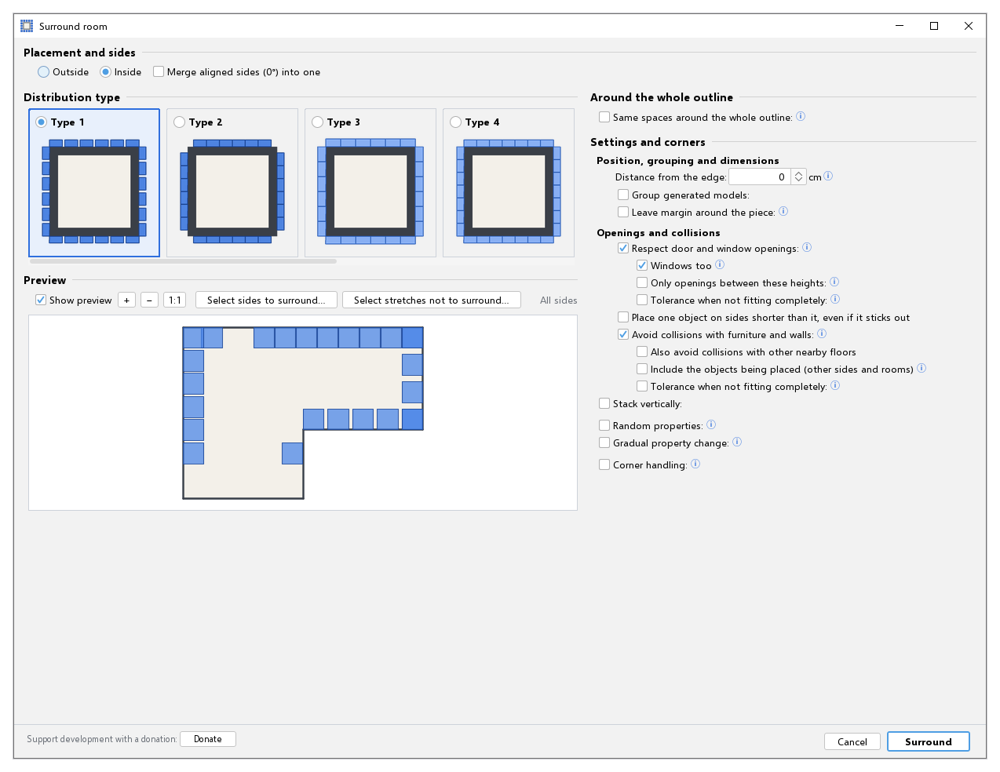
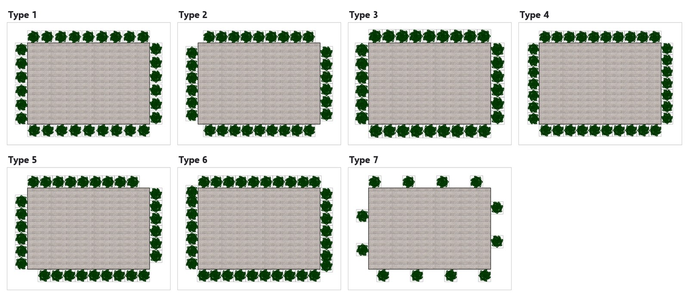

# SurroundRoom

SurroundRoom is a plug-in for [Sweet Home 3D](https://www.sweethome3d.com) that surrounds floors and walls with copies of a piece of furniture: hedges around a garden, chairs along a wall, a fence around a terrace, and so on.

## Features

- Surrounds floors, walls or both, inside or outside.
- 7 distribution types, from evenly spaced objects to a fixed number along the whole outline.
- Live plan preview with zoom and pan.
- Choose the sides to surround and exclude stretches by clicking on the plan.
- Respects door and window openings and avoids collisions with furniture, walls and nearby floors.
- Corner handling: empty corners, a perpendicular piece or another catalog piece in each corner.
- Start and end of each side: at the vertex, shifted, fitted to the other strip or with an extra object.
- Same dimensions or same spaces around the whole outline, with limits.
- Vertical stacking, grouping of the generated models, and random or gradual properties (size, elevation, angle, color/texture per material, light power...).
- Interface in 19 languages.

## Download and installation

Download `SurroundRoom-2.sh3p` from the [Releases](https://github.com/OliMartinez/SurroundRoom/releases) page or from the [SourceForge ticket](https://sourceforge.net/p/sweethome3d/plug-ins/51/). Double-click it with Sweet Home 3D installed, or copy it into the Sweet Home 3D plug-ins folder and restart the application. Remove older SurroundRoom versions from that folder first.

Requirements: Sweet Home 3D 6.5 or later and Java 8 or later.

## License

Copyright (c) 2024-2026 Oliver Martínez (Ollie_Jess).

SurroundRoom is free software distributed under the GNU General Public License, version 3 or later. See [LICENSE](LICENSE). Sweet Home 3D is distributed separately under the GNU General Public License, version 2 or later.

Thanks to xlance for type 7 and the multi-language support of version 1.3e, which version 2 builds on.
